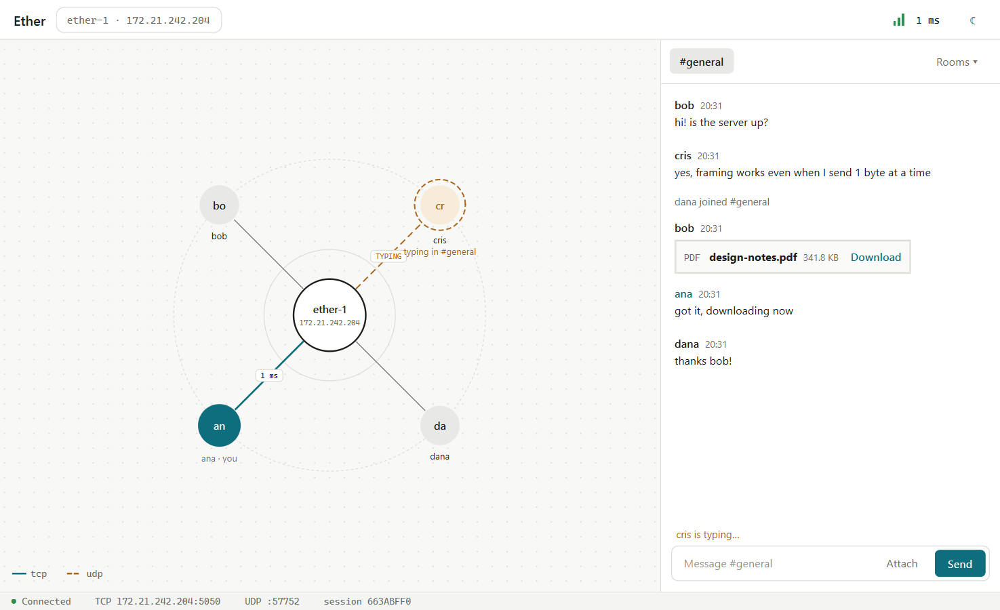
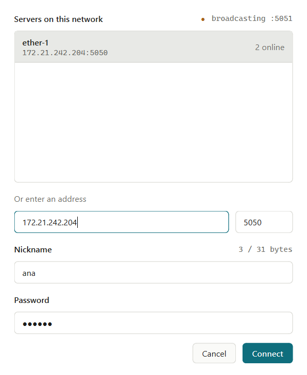
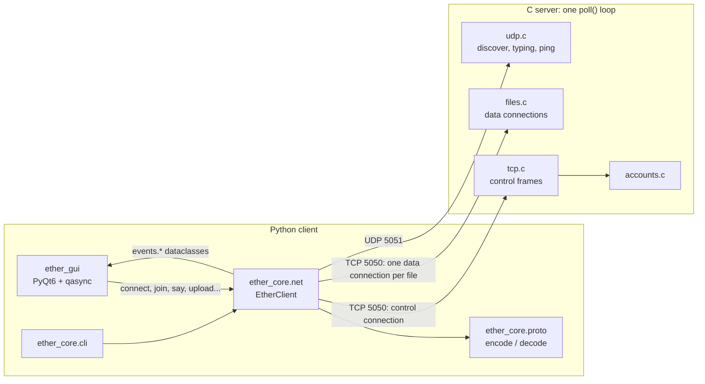
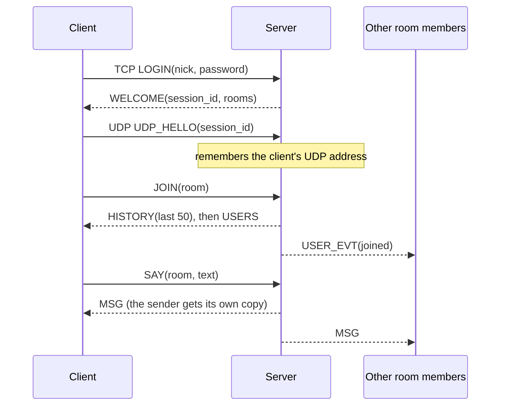
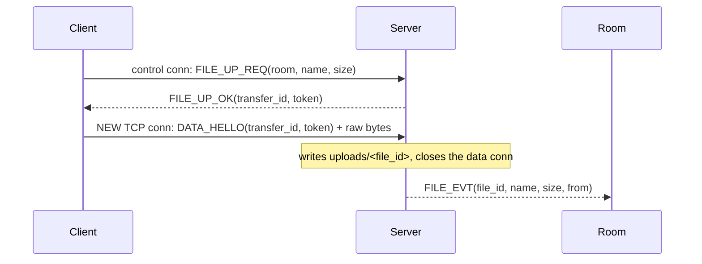

# Ether

LAN chat app. **C server** (single `poll()` loop, TCP + UDP) and **Python client** (asyncio core + PyQt6 GUI), speaking a custom binary protocol.

- **Chat rooms** with history (last 50 messages) and live member lists
- **Accounts** auto-register on first login (salted SHA-512)
- **"is typing…"** and **ping** over UDP
- **File sharing** up to 50 MiB on separate TCP connections
- **LAN discovery**: clients find servers with a UDP broadcast
- **GUI** with an animated network map, plus a **CLI** for debugging

<picture>
  <source media="(prefers-color-scheme: dark)" srcset="docs/main-dark.png">
  
</picture>

*Logged in as ana, with 3 other users on a real server. Solid lines = TCP, dashed = UDP (cris is typing).*

---

## Quick start

### 1. Server (Linux or WSL)

```sh
cd server
make                         # needs gcc + libcrypt (Debian/Ubuntu: build-essential libcrypt-dev)
./ether-server ether-1       # name shown in discovery. Listens on TCP 5050 + UDP 5051
```

Run it from `server/`: it reads/writes `accounts.txt` and `uploads/` in the current directory.

### 2. Client (Python 3.10+, any OS)

```sh
cd client
pip install -r requirements.txt

python -m ether_gui                       # GUI: lists servers found on the LAN
python -m ether_gui --demo                # GUI with a mock backend, no server needed
python -m ether_core.cli --nick ana       # text client, auto-discovers a server
python -m ether_core.cli 192.168.1.40 --nick bob
```

- **New nickname = new account.** The password you type the first time becomes its password.
- **Discovery finds nothing?** Give the server IP directly (CLI argument, or the manual field in the GUI dialog).
- **CLI commands:** `/join N`, `/leave N`, `/up PATH`, `/down FILE_ID DEST`, `/quit`. Any other text is sent to the current room.



*The GUI's connect dialog: servers answering the UDP broadcast appear live, with their online count.*

---

## Architecture



### Three channels, three jobs

| Channel | Transport | Carries | Why this transport |
|---|---|---|---|
| **Control** | TCP 5050, one per user | login, rooms, chat, file requests | must be reliable and ordered |
| **Data** | TCP 5050, a new connection per file | raw file bytes | a 50 MiB upload doesn't block chat |
| **Datagram** | UDP 5051 | discovery, typing, ping | losing one is harmless; broadcast only exists on UDP |

Analogy: control = phone call, data = a courier you send separately, UDP = shouting across the room.

### Repository layout

```
ether/
├── server/                    C server (Linux / WSL)
│   ├── Makefile
│   ├── src/
│   │   ├── main.c             poll() loop, accept, read/write, drop_client
│   │   ├── tcp.c              control frames: login, join/leave, say, file requests
│   │   ├── udp.c              discovery, typing relay, ping
│   │   ├── files.c            data connections, transfer tokens, uploads/<id>
│   │   ├── accounts.c         auto-register, salted SHA-512 via crypt()
│   │   ├── buf.c / buf.h      big-endian write buffer (wbuf) + read cursor (rbuf)
│   │   ├── proto.h            wire constants (mirrors proto.py)
│   │   └── server.h           shared state structs
│   └── tests/test_vectors.c
├── client/
│   ├── requirements.txt
│   ├── ether_core/            networking, no GUI code
│   │   ├── proto.py           pure codec, no I/O (mirrors proto.h)
│   │   ├── net.py             asyncio EtherClient + discover()
│   │   ├── events.py          event dataclasses + exceptions (the GUI contract)
│   │   └── cli.py             text client
│   ├── ether_gui/             PyQt6 "network map" GUI (see ether_gui/README.md)
│   └── tests/                 codec, fake-server, black-box and end-to-end tests
├── shared/vectors.txt         hex test vectors both codecs must match
├── docs/                      README screenshots
└── LICENSE                    GPL-3.0
```

---

## Protocol

All integers are **big-endian**. A string is `[u16 byte_length][UTF-8 bytes]`, no NUL.

### Framing

| Transport | Layout |
|---|---|
| TCP frame | `[u32 length][u8 type][payload]`, where `length` = 1 + payload size, max 64 KiB |
| UDP datagram | `[u16 magic 0x4554 "ET"][u8 version 1][u8 type][u32 session_id][payload]` |

TCP is a byte stream, so the length prefix is how the receiver knows where one message ends.

**Example:** `SAY` "salut" in room 1:

```
00 00 00 0A   05   00 01   00 05 73 61 6C 75 74
length=10     SAY  room=1  str len=5, "salut"
```

### TCP messages

| Type | Name | Direction | Payload |
|---|---|---|---|
| `0x01` | LOGIN | C → S | str nick, str password |
| `0x02` | WELCOME | S → C | u32 session_id, u16 n, n × (u16 room_id, str name) |
| `0x03` | JOIN | C → S | u16 room_id |
| `0x04` | LEAVE | C → S | u16 room_id |
| `0x05` | SAY | C → S | u16 room_id, str text |
| `0x06` | MSG | S → C | u16 room_id, u64 unix_ms, str from, str text |
| `0x07` | HISTORY | S → C | u16 room_id, u16 n, n × MSG payload |
| `0x08` | USERS | S → C | u16 room_id, u16 n, n × str nick |
| `0x09` | USER_EVT | S → C | u16 room_id, u8 joined (1/0), str nick |
| `0x10` | FILE_UP_REQ | C → S | u16 room_id, str filename, u64 size |
| `0x11` | FILE_UP_OK | S → C | u32 transfer_id, u32 token |
| `0x12` | FILE_EVT | S → C | u16 room_id, u32 file_id, str filename, u64 size, str from |
| `0x13` | FILE_DOWN_REQ | C → S | u32 file_id |
| `0x14` | FILE_DOWN_OK | S → C | u32 transfer_id, u32 token, u64 size |
| `0x15` | DATA_HELLO | C → S, data conn | u32 transfer_id, u32 token |
| `0x7E` | ERROR | S → C | u16 code, str message |
| `0x7F` | BYE | C → S | (empty) |

### UDP datagrams

| Type | Name | Direction | Payload |
|---|---|---|---|
| `0x01` | DISCOVER | C → broadcast | (empty, session 0) |
| `0x02` | DISCOVER_REPLY | S → C | str server_name, u16 tcp_port, u16 users_online |
| `0x03` | UDP_HELLO | C → S | (empty): "this address is my UDP endpoint" |
| `0x04` | TYPING | C → S | u16 room_id |
| `0x05` | TYPING_EVT | S → C | u16 room_id, str nick |
| `0x06` | PING | C → S | u64 client_time_ms |
| `0x07` | PONG | S → C | the same u64, echoed back |

### Error codes

| Code | Meaning | Code | Meaning |
|---|---|---|---|
| 1 | nickname already online | 6 | not logged in *(reserved)* |
| 2 | unknown room / not a member | 7 | wrong password |
| 3 | file too large | 8 | message too long |
| 4 | transfer rejected / tables full | 9 | invalid nickname or password format |
| 5 | frame too large *(reserved)* | 10 | no such file |

Codes 5 and 6 are defined but unused: the server just drops those connections.

### Flows

**Login and join**



**File upload** (download is the mirror image)



- **Download:** `FILE_DOWN_REQ` → `FILE_DOWN_OK(id, token, size)` → new connection with `DATA_HELLO` → server streams `size` bytes, then closes.
- **Why a token?** The data connection never logs in. The random, single-use token (valid 30 s) proves it belongs to the request.

---

## Server internals

- **One thread, one `poll()`** over the TCP listen socket, the UDP socket and up to 64 client sockets. Everything is non-blocking.
- **Per-client buffers:** `inbuf` rebuilds whole frames from stream chunks; `outbuf` grows on demand. `POLLOUT` is requested only when `outbuf` is non-empty, otherwise poll would spin at 100% CPU.
- **The first frame decides what a connection is:**

```
                LOGIN ok
  ST_NEW ─────────────────────► ST_CONTROL    chat connection
     │
     ├── DATA_HELLO (upload) ──► ST_UPLOAD    bytes → uploads/<id> → FILE_EVT → close
     ├── DATA_HELLO (download) ► ST_DOWNLOAD  64 KiB chunks from disk → close
     └── anything else ────────► dropped
```

| Piece | How it works |
|---|---|
| **Rooms** | fixed: `1 general`, `2 homework`, `3 games`. Membership = one bit per room in a `u64` mask |
| **History** | ring buffer of 50 messages per room, in RAM |
| **Timestamps** | set by the server, so everyone sees the same order |
| **Accounts** | `accounts.txt`, one `nick:$6$salt$hash` line each (`crypt()` salted SHA-512) |
| **Session id** | random non-zero `u32`; it ties UDP datagrams to a logged-in user |
| **Files** | saved as `uploads/<file_id>`, never under the client's filename (no `../../etc/passwd`) |
| **Typing** | relayed at most once per second per user |

## Client internals

| Piece | How it works |
|---|---|
| `proto.py` | pure encode/decode, no sockets. `decode_udp` never raises, since anyone on the LAN can send junk |
| `net.py` connect | TCP login → open UDP socket → `UDP_HELLO` → start the reader task and the UDP loop |
| UDP loop | `PING` every 2 s (becomes `Pong(rtt_ms)`), `UDP_HELLO` every 10 s so NAT mappings don't expire |
| Request/reply | `FILE_*_OK` carry no request id, so a lock allows one pending request at a time; replies arrive in order |
| Discovery | broadcasts from **every** local IPv4 adapter: Windows sends `255.255.255.255` out of only one |
| Safety | UDP accepted only from the server's IP; a failed download deletes the partial file |
| `events.py` | the only contract with the GUI. `MainWindow` dispatches on the event **class name**, so `--demo` runs with no networking |

---

## Limits

| Thing | Limit | Thing | Limit |
|---|---|---|---|
| nickname | 31 bytes UTF-8, no `:` | TCP frame | 64 KiB |
| password | 64 bytes | connections | 64 (data conns count too) |
| chat message | 4000 bytes | accounts | 256 |
| file | 50 MiB | files per server run | 256 |
| history | 50 messages / room | concurrent transfers | 32 |

## Testing

Both codecs are checked against the same hex bytes in `shared/vectors.txt`. If C and Python both pass, they agree on the wire.

| What it tests | Run from | Command | Needs a server? |
|---|---|---|---|
| C codec vs vectors | `server/` | `make test` | no |
| Python codec vs vectors | `client/` | `python -m pytest tests` | no |
| `net.py` vs a fake server | `client/` | `python tests/net_client.py` | no |
| C server, black-box over raw sockets | `client/` | `python tests/net_server.py --host IP` | yes |
| Full client ↔ server | `client/` | `python tests/net_e2e.py --host IP` | yes |

Script flags: `--slow` (extra tests), `-k NAME` (filter), `-v` (tracebacks). `ETHER_HOST` sets the default host.

---

## Known limitations

- **No encryption.** Passwords cross the network in plain text (they are only *stored* hashed). Use on a trusted LAN.
- **HISTORY can outgrow a frame.** 50 long messages exceed 64 KiB; the client rejects the frame and disconnects.
- **State lives in RAM.** History and the file table reset when the server restarts, and new uploads reuse ids, overwriting old `uploads/<id>` files.
- **No auto-reconnect** in the GUI after a disconnect.
- **IPv4 only**, fixed ports, and the server is Linux-only (`poll`, `getrandom`, `crypt`). WSL works.

## License

[GPL-3.0](LICENSE), required by PyQt6.
